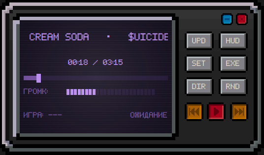

# RetroDeck Music Player

Легковесный десктопный аудиоплеер для Windows в стиле ретро-магнитолы 90-х. 
Создан для прослушивания локальной музыки во время игр (Forza Horizon, Cyberpunk и др.) с автоматическим запуском/паузой по процессам и прозрачным оверлеем в стиле Need for Speed.

---

## Ключевые возможности

* **Интеграция с играми (WMI Watcher):** отслеживает запуск выбранного `.exe`. Музыка плавно включается с 5-секундным нарастанием громкости (fade-in) при входе в игру и автоматически встаёт на паузу при её закрытии.
* **NFS-Style HUD (Оверлей):** прозрачный баннер поверх игры на 4 секунды при переключении трека. Сквозной клик (`WS_EX_TRANSPARENT`), не перехватывает управление и не сбивает фокус в полноэкранных играх (Borderless/Windowed).
* **24-ступенчатая логарифмическая громкость:** квадратичная кривая `(step / 24) ** 2.2`. Нижние деления позволяют слышать фоновую музыку так, чтобы она не перебивала голос в Discord.
* **Встроенный интерфейс (On-Screen BIOS):** настройки хоткеев, таймеров и выбор процессов встроены прямо в LCD-экран магнитолы (без системных окон Windows).
* **6 тем дисплея:** переключение цветовой палитры экрана и оверлея (Зелёный, Фиолетовый, Красный, Голубой, Оранжевый, Жёлтый) с эффектом ЭЛТ-стекла и сканлайнами.
* **Полная сохранность состояния:** плеер запоминает последний игравший файл и точную секунду паузы, восстанавливая их после перезагрузки ПК.
* **Работа в фоне:** окно сворачивается в системный трей, защита от запуска дубликатов процесса (Single Instance).

---

## Управление по умолчанию

| Действие | Комбинация клавиш | Кнопка на панели |
| :--- | :--- | :--- |
| **Следующий трек** | `Ctrl + Alt + Right` | `>>\|` |
| **Предыдущий трек** | `Ctrl + Alt + Left` | `\|<<` |
| **Пуск / Пауза** | `Ctrl + Alt + Space` | `▶` / `❚❚` (красная) |
| **Громче** | `Ctrl + Shift + Up` | Шкала на дисплее |
| **Тише** | `Ctrl + Shift + Down` | Шкала на дисплее |
| **Случайный трек** | — | `RND` |
| **Обновить плейлист** | — | `UPD` |
| **Тест оверлея** | — | `HUD` |
| **Настройки на экране**| — | `SET` |
| **Выбор игры** | — | `EXE` |

*Все комбинации клавиш можно переназначить прямо на экране в меню `SET`.*

---

## Быстрый старт (для пользователей)

1. Скачайте архив из раздела **[Releases](../../releases)**.
2. Распакуйте в любую папку.
3. Положите свои `.mp3` файлы в папку `music/` или любую другую и выберите папку по кнопке `DIR`.
4. Запустите `RetroPlayer.exe`.
5. Нажмите кнопку `EXE` ➔ выберите игру из запущенных или укажите файл на диске.

---

Архитектура проекта

ui.py — интерфейс PyQt6, рендеринг спрайтов, CRT-дисплей, экранные меню, логика оверлея.
player.py — аудиодвижок на базе pygame-ce, логарифмическая громкость, кэширование метаданных.
wmi_watcher.py — асинхронный мониторинг системных событий запуска и остановки процессов через WMI (Win32_ProcessStartTrace, Win32_ProcessStopTrace).
assets/ — растровые спрайты кнопок, корпуса и пиксельный шрифт thin_pixel-7.ttf.
